# aequalyn-installer

The Aequalyn installer: a guided installer written in QML (Quickshell) that
writes an `install.toml`, shows it for review, and applies it only after you
approve.

| | |
| --- | --- |
| `aequalyn-install` | QML wizard + applier (`--config install.toml` for unattended installs) |
| `aequalyn-detect` | Hardware detection and a proposed profile (`aequalyn-install --detect`) |
| `aequalyn-repair` | Chroot into an existing install from the live ISO |
| `lib/apply.sh` | Partitioning (full wipe, dual boot, manual), LUKS2, Btrfs subvolumes, Limine, snapper |
| `install.toml.example` | Every option, documented |

The interactive UI lives in `shell.qml` / `Installer.qml` and runs under
Quickshell. `aequalyn-install` launches it; the legacy command-line flags are
delegated to `aequalyn-install-cli`.

On the live ISO it lives in `/opt/aequalyn/installer` next to the core tree
and the package lists ([aequalyn-iso](https://github.com/Aequalyn/aequalyn-iso)
assembles them). Everything works without AI.

## The flow, screen by screen

Every screen, rendered from the installer itself (`screenshots/`; the
identity, timezone and disk values are representative).

**1-2 · Welcome and Identity** -- the hardware proposal with the
connectivity verdict and the import row; then hostname, user, keymap,
password and the timezone globe: drag to rotate, click a station, and
Ctrl + scroll to zoom it. Every screen fits the window as it is, with no
scrolling: the whole installer scales to the size of the screen.

| 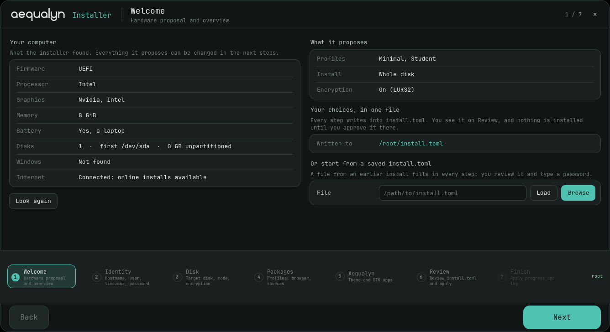 | 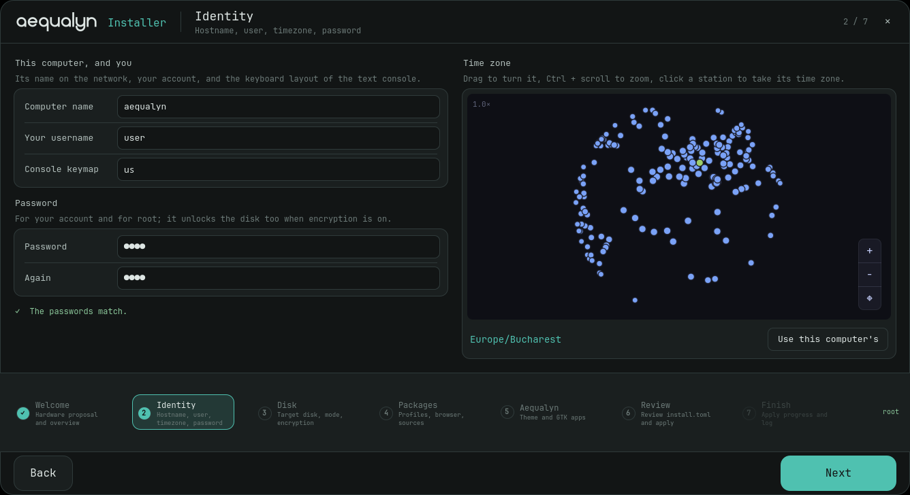 |

**3-4 · Disk and Packages** -- the target, the install mode, LUKS2 and the
ESP size; then profiles, browser, Flatpak and the package source, which
proposes the bundled offline repository when there is no internet.

| 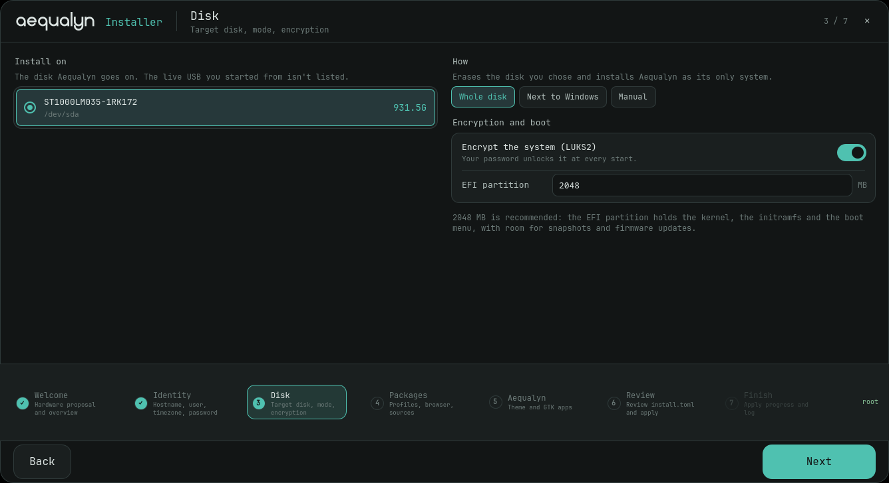 | 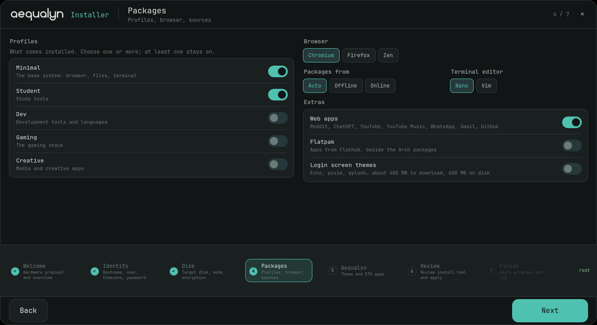 |

**5-6 · Aequalyn and Review** -- the colour mode and the GTK theming; then
the exact `install.toml` about to be applied, with the Install button that
commits the wizard (the Close installer button never comes back after it).

| 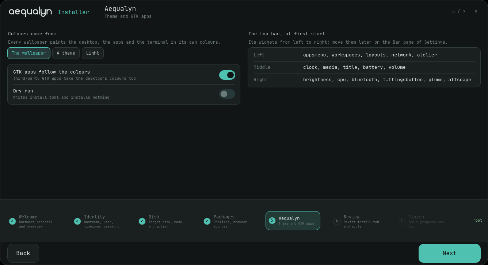 | 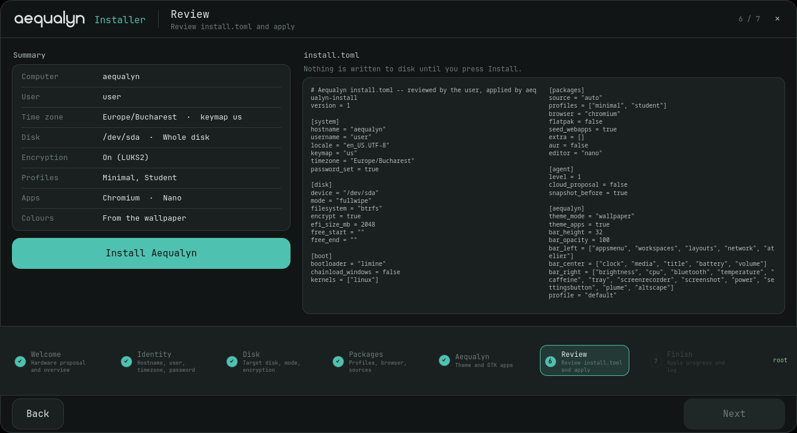 |

**7-8 · The run, and the moment it completes** -- progress and the live log
while the wizard is locked; then Finish acknowledges the result.

| 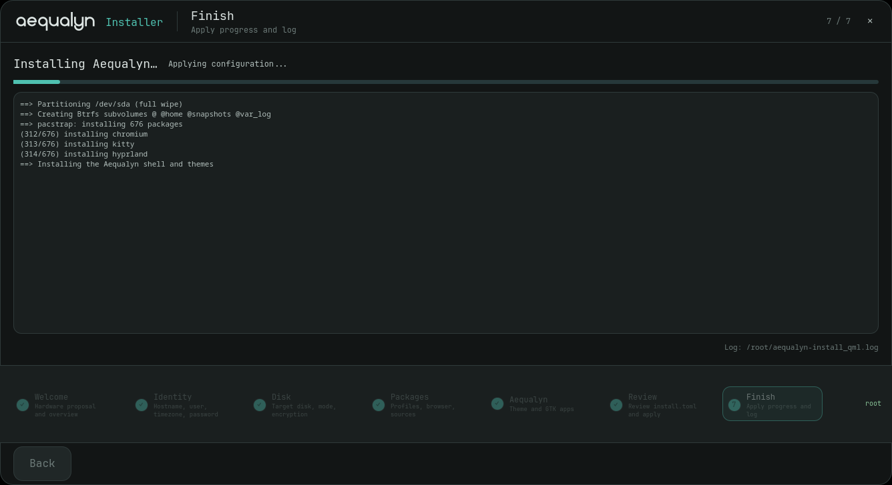 | 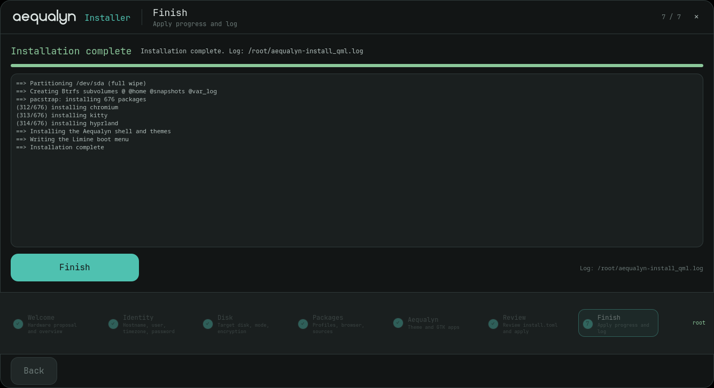 |

**9 · The goodbye** -- Reboot Now follows Finish, and the full-screen
"Enjoy Your Distro!" splash covers everything right before the reboot.

| 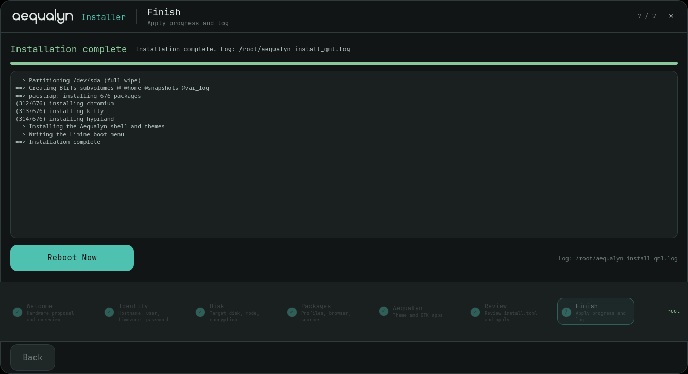 | 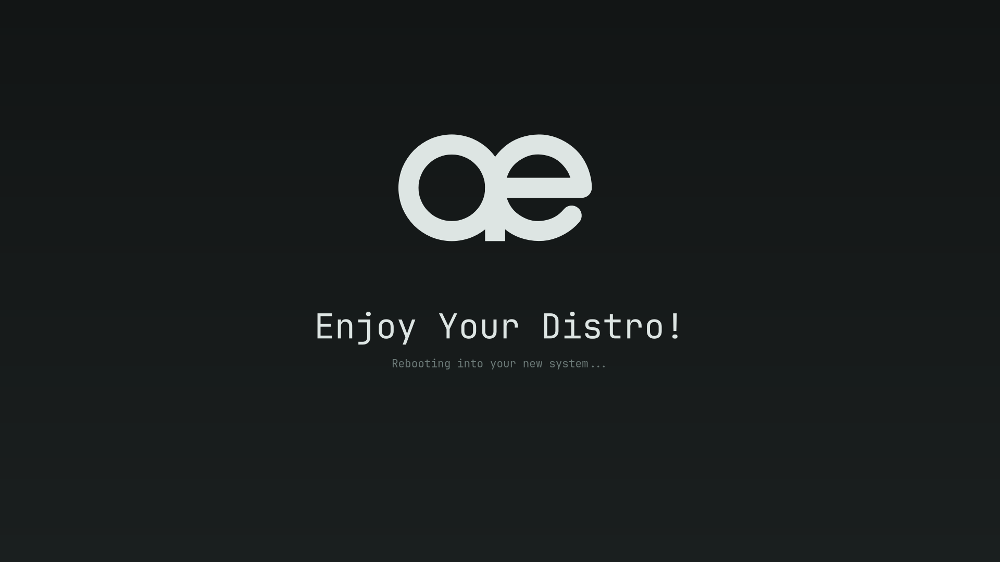 |

**10-11 · A failure, online** -- the wizard unlocks for a retry and the
Discord invite appears with a scannable QR. Debug opens an AI repair
session in foot (`opencode --auto` on a generated skill); Retry goes back
to the review page with the config intact.

| 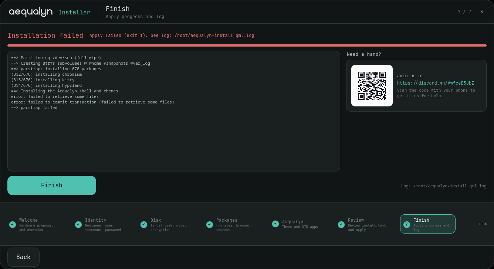 | 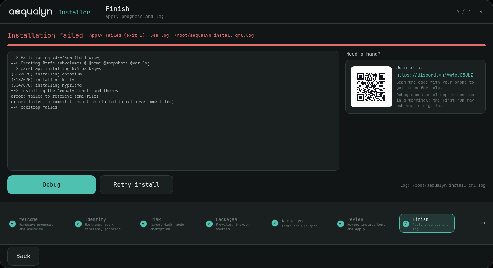 |

**12 · A failure, offline** -- no network, no AI session: an apology page
pointing at the log instead.

| 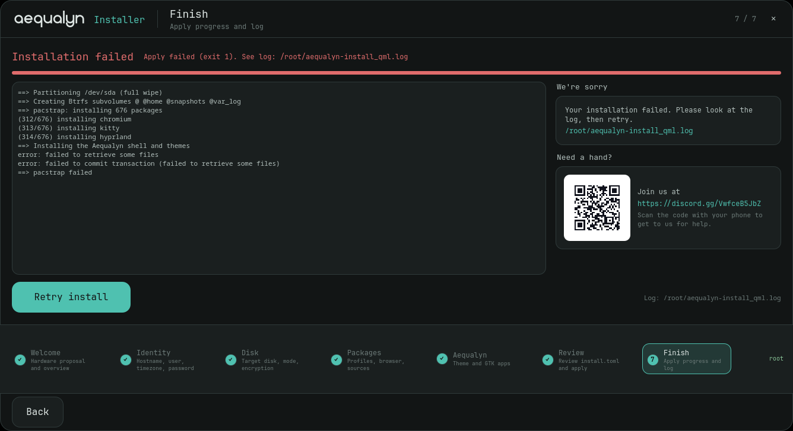 |

## The end of the wizard

Once Install is pressed the wizard is committed -- the Close installer button
is gone for good -- and the Finish page tracks the run. Success is staged:
Finish, then Reboot Now, then a full-screen "Enjoy Your Distro!" splash right
before the reboot. A failure unlocks the wizard for a retry and shows the
Discord invite next to its QR code (`assets/discord-qr.png`, regenerate it
with `segno.make(url, error='m').save(..., scale=10, border=4)` whenever the
invite changes -- the invite itself lives in the `discordInvite` property in
`Installer.qml`):

- **Debug** (only with internet) writes `~/.config/opencode/skills/aequalyn-debug/SKILL.md`
  -- the live ISO and session details, the distribution, the script, config
  and log locations, and the job: fix the install and get it to the last step,
  or explain how to restart it -- then opens foot running `opencode --auto`
  with a prompt that loads the skill (`@aequalyn-debug`).
- **Retry install** returns to the review page with the config intact.
- Offline failures get an apology page pointing at the log instead: there is
  no network to run an AI session on.

Connectivity is probed the way `lib/apply.sh` probes it (`ping -c 1 -W 2
archlinux.org`); with no internet the proposed package source also defaults
to the bundled offline repository. The globe on the Identity page zooms on
Ctrl + wheel and leaves a plain wheel alone.

## The qt5 dialog hook

`lib/apply.sh` plants a pacman hook into every fresh install:
`/etc/pacman.d/hooks/aequalyn-qt5-dialogs.hook` runs the core tree's
`bin/aequalyn-qt5-dialogs` whenever vlc -- the one qt5 app this knows
about -- is installed, upgraded or removed, so the patch happens the
moment pacman finishes, however much later that is.

The engine gives each Aequalyn user's home two small things: a
`~/.local/bin/vlc` wrapper that points the app at Qt5's own
`xdgdesktopportal` theme (Qt5 ignores the session's
`QT_QPA_PLATFORMTHEME=qt6ct`, which is what routes Qt6 apps to the
portal), and a local desktop entry that names the wrapper outright,
because launchers resolve `Exec`'s bare name through `/usr/bin`, not
the user's `PATH`. With those, vlc's open and save dialogs come from the
same Aequalyn FM window every GTK and Qt6 app uses. Generated files are
marked (`X-Aequalyn-Generated`) and regenerated from the app's own
system entry on upgrades; the person's own files are never touched, and
a removal takes back only what was generated.

Installs made before the hook existed get it from
[aequalyn](https://github.com/Aequalyn/aequalyn) migration
`20261118-3`, which `aequalyn-update` runs (and which patches a vlc
already installed). The installer plants the hook outright only because
a fresh system has no migrations to run; everything after that is the
hook's job.

## Credits

[nightdevil00](https://github.com/nightdevil00) contributed to the code here.
