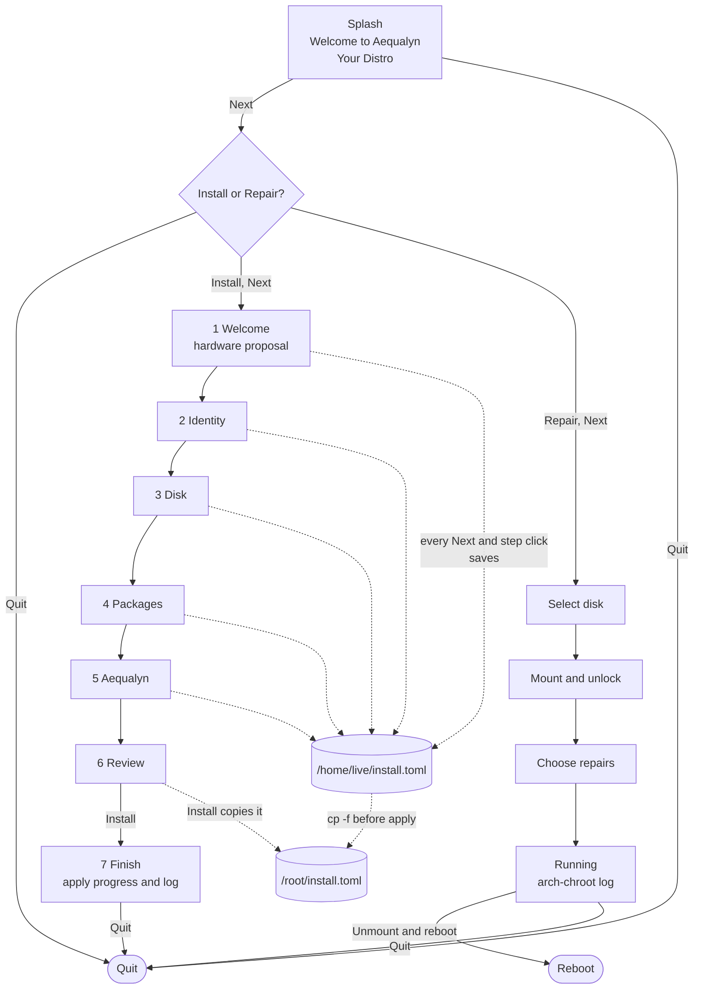

# Aequalyn Installer Guide

The installer runs from the live ISO. It has two jobs:

- **Install** Aequalyn on a disk, from a step-by-step wizard.
- **Repair** an existing install: mount the disk, unlock it if it is encrypted, and reinstall the keyring, kernel or bootloader inside `arch-chroot`.

Everything the wizard decides is saved to one file, `install.toml`, so an install can be reviewed, edited by hand, and repeated exactly.

---

## 1. Starting it

Open **Install Aequalyn** from the dock or the application menu. It runs `sudo -E aequalyn-install`, so the installer runs as root. Root is required to partition disks and to write `/root/install.toml`.

From a terminal, the same wizard starts with:

```bash
sudo aequalyn-install
```

---

## 2. The flow at a glance



The step bar at the bottom shows the seven install steps. It is hidden on the splash and the Install/Repair choice, and on the repair pages.

---

## 3. Screens

### 3.1 Splash

```
+--------------------------------------------------+
|                                                  |
|            Welcome to Aequalyn                   |   <- sky of aequalyn-horizon
|                                                  |
|   ~~~~~~~~~~~~ aequalyn ~~~~~~~~~~~~~~           |   <- the word on the horizon
|   ~~~~~~~~~~~~ (reflection) ~~~~~~~~~~~          |
|                                                  |
|                 Your Distro                      |   <- sea
|--------------------------------------------------|
| [ Quit ]                              [ Next ]   |
+--------------------------------------------------+
```

The background is `assets/aequalyn-horizon.svg`.

### 3.2 Install or Repair

```
+--------------------------------------------------+
|  What would you like to do?                      |
|                                                  |
|  +--------------------------------------------+  |
|  | Install                        (selected)  |  |
|  | Use this wizard to install Aequalyn on     |  |
|  | your computer.                             |  |
|  +--------------------------------------------+  |
|  +--------------------------------------------+  |
|  | Repair                                     |  |
|  | Allows you to mount your disk and perform  |  |
|  | repairs or updates.                        |  |
|  +--------------------------------------------+  |
|--------------------------------------------------|
| [ Quit ]                              [ Next ]   |
+--------------------------------------------------+
```

Click a card to select it. **Next** continues with the selected choice.

### 3.3 Install wizard

The footer has **Back** on the left and **Next** on the right. Back from the first install step returns to the Install/Repair choice.

| # | Page | What you set | Notes |
|---|------|--------------|-------|
| 1 | **Welcome** | Reads the hardware proposal (firmware, CPU, GPU, memory, disks, Windows EFI, profiles, mode). | Shows the saved `install.toml` path. Re-detect runs the detection again. |
| 2 | **Identity** | Hostname, username, timezone, console keymap, password. | Timezone is picked on the globe (see 4.2). The password is used for the user, root and the LUKS passphrase, and is never written to `install.toml`. |
| 3 | **Disk** | Target disk, install mode, LUKS2 encryption, EFI partition size. The **What will happen** panel lists the current partitions and every change the install will make. | Modes: `fullwipe` (erase the disk), `dualboot` (use the largest free region and keep Windows), `manual`. The live USB disk is never listed. `dualboot` needs 12 GiB of unallocated space: without it the panel says so and Next stays disabled. |
| 4 | **Packages** | Profiles (minimal, student, dev, gaming, creative), browser, web apps, Flatpak, lock screens, package source, terminal editor. | At least one profile is required. |
| 5 | **Aequalyn** | Colour mode and whether GTK apps follow the theme. Dry run option. | Dry run writes `install.toml` and stops before partitioning. |
| 6 | **Review** | The generated `install.toml`, read-only, and the **Install** button. | The Install button is the only way to start an install. |
| 7 | **Finish** | Apply progress bar, a live log, **Reboot now** and **Quit**. | **Quit** is greyed out while the install runs. |

Example of the **Disk** page:

```
+--------------------------------------------------+
|  TARGET DISK        [ /dev/nvme0n1  476G  ... v ]|
|  INSTALL MODE       [ fullwipe              v ]  |
|  [x] Encrypt root with LUKS2                     |
|  Selected: /dev/nvme0n1                          |
|  EFI PARTITION SIZE (MB)   [ 2048 ]              |
|--------------------------------------------------|
| [ Back ]                              [ Next ]   |
+--------------------------------------------------+
```

### 3.4 Finish page while installing

```
+--------------------------------------------------+
|  Finish                                          |
|  Applying configuration...                       |
|  [=========================>            ]         |
|  +----------------------------------------------+|
|  | ==> Partitioning /dev/nvme0n1                ||
|  | ==> Creating btrfs subvolumes                ||
|  | ...                                          ||
|  +----------------------------------------------+|
|  [ Reboot now ]  (disabled)     [ Quit ] (grey)  |
+--------------------------------------------------+
```

When the install finishes, **Reboot now** is enabled. **Quit** is enabled again if the install fails.

---

## 4. Details that matter

### 4.1 `install.toml` and where it lives

| File | Who writes it | When |
|------|---------------|------|
| `/home/live/install.toml` | The wizard | At startup (the hardware proposal), and on every **Next** or step click |
| `/root/install.toml` | The installer | Copied from `/home/live/` right before **Install** starts the applier |

You only edit `/home/live/install.toml`. If the file already exists at startup, the wizard loads it instead of the proposal. Pressing **Next** rewrites the file from the current choices, so anything you changed by hand that the wizard does not model will be overwritten.

To load a file from elsewhere, use **Load** on the Welcome page, or **Browse**. The file is copied to `/home/live/install.toml` unchanged, and the wizard jumps to Review.

The installer log is written to `/root/aequalyn-install_qml.log`. When the apply finishes, success or failure, it is copied to `/home/live/aequalyn-install_qml.log` with mode `644`, so the live user can open it.

### 4.2 Timezone globe

The Identity page has a 3D globe for the timezone. The page is scrollable:

- Plain mouse wheel over the globe **scrolls the page**.
- **Ctrl + wheel** over the globe **zooms** the globe.
- Click a station to pick its timezone.

### 4.3 Repair flow

```
Select disk             Mount & unlock          Choose repairs            Running
+-------------------+   +-------------------+   +-------------------+     +-------------------+
| (o) nvme0n1 476G  |   | Encrypted (LUKS)  |   | [x] Reinitialize  |     | [x] keyring  done |
| ( ) sda 931G      |-->| passphrase: ****  |-->|     archlinux-    |---->| [x] kernel  run  |
| ( ) sdb 1.8T      |   | [Unlock & mount]  |   |     keyring       |     | [ ] bootloader    |
|                   |   | mounted on /mnt  |   | [x] Reinstall     |     | log: arch-chroot  |
| [Quit]    [Next]  |   | [Back]   [Next]   |   |     linux kernel  |     |  ...              |
+-------------------+   +-------------------+   | [ ] Reinstall     |     | [Quit] [Unmount & |
                                               |     bootloader    |     |       reboot]     |
                                               | [Back] [Run]      |     +-------------------+
                                               +-------------------+
```

What each repair does, inside `arch-chroot /mnt`:

| Option | What runs | When to use it |
|--------|-----------|----------------|
| Reinitialize archlinux-keyring | Removes `/etc/pacman.d/gnupg`, runs `pacman-key --init` and `--populate archlinux`, then `pacman -Sy archlinux-keyring` | "invalid or corrupted package", signature errors |
| Reinstall linux kernel | `pacman -S linux`, then `mkinitcpio -P` | Broken kernel or initramfs |
| Reinstall bootloader | `pacman -S limine`, copies Limine to `/boot/EFI`, runs `limine-update` (BIOS: `limine bios-install`) | Missing or broken boot entry |

Mounting follows the same layout as the installer. Btrfs root is mounted from `@`, with `@home`, `@var`, `@log`, `@pkg`, `@.snapshots` and `@root` mounted when present. The EFI partition labelled `AEQUALYN` goes to `/mnt/boot`.

Repairs stop at the first failed step, and the log shows the error. **Unmount & reboot** unmounts `/mnt` and closes the LUKS mapping before rebooting.

### 4.4 Command line

The same installer can run without the GUI:

```bash
sudo aequalyn-install --config /home/live/install.toml   # apply a file
sudo aequalyn-install --detect                           # print the hardware proposal
sudo aequalyn-install --dry-run                          # write the config only
sudo aequalyn-install --repair                           # text-mode repair
```

---

## 5. Troubleshooting

| Symptom | Check |
|---------|-------|
| Install does not start | Check the status line under the Install button. It names the missing password or disk. |
| "Failed to write install.toml" | `/home/live/` must exist and be writable. |
| "Could not copy install.toml to /root" | The installer must run as root. Start it from the dock or with `sudo`. |
| Repair says no root partition | The disk may have no LUKS or btrfs/ext4/xfs partition. Check with `lsblk -f`. |
| Wrong passphrase | Unlock fails with `could not unlock`. Try the passphrase again. |
| Dock shows a generic icon for Install | The ISO was built without the Aequalyn icon. Rebuild the ISO from `aequalyn-iso`. |

Logs:

- Install: `/root/aequalyn-install_qml.log`. The applier's output goes to the same file, and the Finish page shows its path.
- Repair: the log panel on the mount and running pages.
